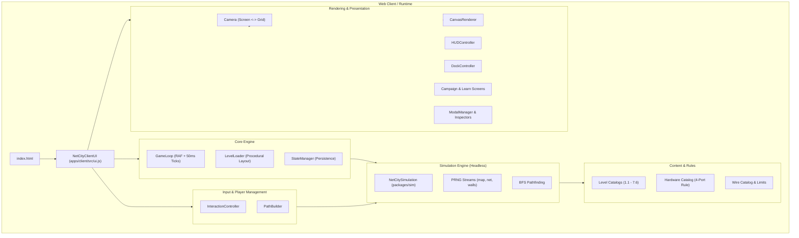

# NetCity v2.0 &mdash; Technical Architecture

This document provides a comprehensive overview of the technical structure, design patterns, file layout, and component responsibilities for **NetCity v2.0** &mdash; a standalone educational network puzzle and simulation game.

---

## 1. High-Level Architectural Overview

NetCity v2.0 follows a modular, decoupled architecture rooted in **Unidirectional Data Flow**, the **Model-View-Controller (MVC)** separation, and the **Facade Pattern**.



### Key Technical Pillars:
1. **Headless, Deterministic Simulation Engine (`packages/sim`)**:
   - The simulation runs entirely decoupled from the DOM and Canvas.
   - Uses independent, seeded pseudo-random streams (`map`, `net`, `walls`) to guarantee that given the same seed and level ID, building layouts and packet arrival sequences are 100% deterministic and reproducible across page reloads and rewind cycles.
2. **Fixed-Timestep Game Loop (`apps/client/src/core/game-loop.js`)**:
   - Decouples visual frame rate (`requestAnimationFrame`) from physics/packet ticks.
   - Ticks execute in discrete 50ms steps (`tickAccumulator`) with variable speed multipliers (1&times;, 2&times;, 4&times;) and pause/resume capability.
3. **Pure Native ESM (Zero Bundlers Required)**:
   - All modules use standard ECMAScript Module (`import` / `export`) syntax with relative pathing.
   - The same modules execute seamlessly in modern desktop/mobile web browsers and in server/test environments with Node.js.
4. **Adaptive Viewport & Coordinate Isolation (`apps/client/src/rendering/camera.js`)**:
   - Isolates Canvas rendering from browser DPI, pan offsets, and zoom factors.
   - Centralizes `screenToGrid` and `gridToScreen` transformations for pixel-perfect drag and drop.
5. **Strict Single Responsibility Principle (SRP)**:
   - UI monolith (`ui.js`) is refactored into focused, isolated subsystems for game loop timing, rendering pipelines, input handling, screens, and specialized hardware modal inspectors.

---

## 2. Directory Tree

```
clever-brahmagupta/
├── ARCHITECTURE.md                  # Comprehensive architectural specification (this file)
├── server.js                        # Root Express server (serves client & legacy MVP routes)
├── package.json                     # Monorepo root workspace configuration
│
├── apps/
│   └── client/                      # Standalone Web Game Frontend
│       ├── package.json             # Client app configuration
│       ├── server.js                # Client development server & static asset mount
│       ├── public/                  # Public web root
│       │   ├── index.html           # Standalone game entry point
│       │   ├── game.css             # Fullscreen responsive styling & UI theme
│       │   └── assets/              # Static game assets
│       │       └── images/
│       │           ├── buildings/   # Building SVGs (home, laptop, classroom, etc.)
│       │           ├── chapters/    # Chapter banner 3D renders (PNG) & vector fallbacks (SVG)
│       │           ├── devices/     # Hardware appliance SVGs (switch, router, AP, etc.)
│       │           └── ui/          # UI badges, locks, logos
│       │
│       └── src/                     # Client application source code
│           ├── assets.js            # AssetManager: Image preloading, caching & vector fallbacks
│           ├── generate-assets.js   # Procedural asset generation script
│           ├── ui.js                # Top-level Orchestrator & Backward-Compatible Facade
│           │
│           ├── core/                # Core Simulation & Game Loop Subsystems
│           │   ├── game-loop.js     # RAF game loop, fixed 50ms ticks & speed controls
│           │   ├── level-loader.js  # Procedural map generation, seeded buildings & walls
│           │   └── state-manager.js # localStorage persistence & campaign progress tracking
│           │
│           ├── rendering/           # HTML5 Canvas Rendering Engine
│           │   ├── camera.js        # Viewport zoom/pan & screen/grid coordinate transformations
│           │   ├── draw-utils.js    # Canvas geometric primitives (round-rects, cables, packets)
│           │   └── canvas-renderer.js # Complete multi-layer canvas rendering pipeline
│           │
│           ├── input/               # Player Input & Interaction
│           │   ├── path-builder.js  # Live cable path construction, backtracking & validation
│           │   └── interaction-controller.js # Pointer/touch/keyboard event listeners & tools
│           │
│           └── ui/                  # DOM UI Components & Screens
│               ├── hud-controller.js # Topbar HUD metrics (coins, deliveries, stars, hints)
│               ├── dock-controller.js # Floating bottom dock (cables vs devices palette)
│               ├── screens/
│               │   ├── campaign-screen.js # Fullscreen campaign portal & chapter carousel
│               │   ├── learn-screen.js    # Interactive Field Manual & networking guides
│               │   └── endless-screen.js  # Endless Metropolis portal, tier progress & leaderboards
│               └── modals/
│                   ├── modal-manager.js     # Modal overlay container & backdrop lifecycle
│                   ├── level-end-modal.js   # Victory (Level Won) & Failure (Level Over) dialogs
│                   ├── diagnostics-modal.js # Bit's Diagnostic Toolkit (Ping & Packet Trace)
│                   └── inspectors.js        # Hardware inspectors (Switch, Router, Firewall, etc.)
│
├── packages/
│   ├── content/                     # Game Curriculum, Devices & Cable Specifications
│   │   ├── package.json
│   │   └── src/
│   │       ├── devices.js           # 13 hardware device specifications & 4-Port Rule
│   │       ├── levels.js            # 44 level definitions across Chapters 1 through 7
│   │       ├── wires.js             # 4 cable specifications (Twisted Pair, Coaxial, Fibers)
│   │       ├── endless-config.js    # Endless Mode dynamic tier resolver & pacing configurations
│   │       └── index.js             # Public content package entry point
│   │
│   └── sim/                         # Headless Simulation Engine
│       ├── package.json
│       └── src/
│           ├── prng.js              # Deterministic pseudo-random number generators
│           ├── pathfinding.js       # Breadth-First Search (BFS) grid pathfinding
│           ├── sim.js               # Core simulation state machine & event dispatcher
│           └── index.js             # Public sim package entry point
│
└── test/                            # Comprehensive Automated Test Suite (82 tests)
    ├── mock-dom.js                  # Headless DOM and Canvas mock for Node.js test runs
    ├── campaign-assets.test.js      # Asset catalogs, carousel UI & screen transitions
    ├── ch1-ch2.test.js              # Chapter 1 & 2 curriculum, AP wireless, cabinets, switches
    ├── ch3-ch4.test.js              # Chapter 3 & 4 routing, subnets, DHCP, DNS, round-trip web
    ├── ch5-ch7.test.js              # Chapter 5-7 VLANs, firewalls, encryption, load balancers
    ├── v2-sim.test.js               # Headless simulation mechanics, quotas, timers, rewind
    └── audit.test.js                # Game design audits, PRNG determinism & wall verification
```

---

## 3. Component Responsibility & Interaction Matrix

| File / Module | Single Responsibility (SRP) | Key Exports | Interacts With (Imports / Inbound) | Interacts With (Used / Outbound) |
| :--- | :--- | :--- | :--- | :--- |
| `apps/client/src/ui.js` | Top-level orchestrator and facade exposing the unified `NetCityClientUI` API. | `NetCityClientUI` | `index.html`, test suites (`test/*.test.js`) | `StateManager`, `LevelLoader`, `GameLoop`, `Camera`, `CanvasRenderer`, `PathBuilder`, `InteractionController`, `HUDController`, `DockController`, `CampaignScreen`, `LearnScreen`, `ModalManager`, `Inspectors` |
| `apps/client/src/core/state-manager.js` | Persistence of user progression, completed levels set in `localStorage`, and screen navigation state. | `StateManager` | `ui.js` | `localStorage` browser API |
| `apps/client/src/core/level-loader.js` | Procedural generation of deterministic level maps, seeded building coordinates, and non-overlapping walls. | `generateLevelMap`, `findValidSquare` | `ui.js`, `audit.test.js` | `packages/content/src/levels.js`, `packages/sim/src/prng.js` |
| `apps/client/src/core/game-loop.js` | Fixed-timestep simulation execution (50ms accumulator), RAF animation loop, speed scaling (1&times;, 2&times;, 4&times;), and collision bursts. | `GameLoop` | `ui.js` | `NetCitySimulation`, `window.requestAnimationFrame` |
| `apps/client/src/rendering/camera.js` | Viewport transformation between screen pixels and grid coordinates, zoom factors, panning, and auto-fit. | `Camera` | `ui.js`, `canvas-renderer.js`, `interaction-controller.js` | HTML5 Canvas dimensions |
| `apps/client/src/rendering/draw-utils.js` | Geometric path helpers: polyfilled rounded rectangles, styled cable ribbons with drop shadows, and interpolated packet positions. | `drawRoundRect`, `drawWirePath`, `getPathPoint` | `ui.js`, `canvas-renderer.js` | Canvas 2D Context |
| `apps/client/src/rendering/canvas-renderer.js` | Rendering the complete visual game scene: grid, rivers, bridges, walls, noisy/snoop zones, cables, packets, buildings, timers, devices, LEDs, and drag previews. | `CanvasRenderer` | `ui.js` | `draw-utils.js`, `assets.js`, `packages/content/src/wires.js`, `packages/content/src/devices.js` |
| `apps/client/src/input/path-builder.js` | Dynamic interactive cable path construction during pointer drag: cardinal adjacency, backtracking removal, and live validation. | `PathBuilder` | `ui.js` | `NetCitySimulation.validateWire()` |
| `apps/client/src/input/interaction-controller.js` | Pointer events (down, move, up), tool selection, device placement & pickup/relocation (100% refund), keyboard shortcuts (`1`–`9`, `Space`, `Esc`), and cleanup. | `InteractionController` | `ui.js` | `packages/content/src/devices.js`, `packages/content/src/wires.js` |
| `apps/client/src/ui/hud-controller.js` | Updating HUD metrics: level title, goal description, coin balance, delivered packet count, happiness meter, and alert hint banners. | `HUDController` | `ui.js` | DOM elements (`#nc-title`, `#nc-coins-display`, etc.) |
| `apps/client/src/ui/dock-controller.js` | Bottom palette category switching (Cables vs Devices tab), tool unlock visibility, and active selection state. | `DockController` | `ui.js` | DOM elements (`#nc-dock-cables`, `#nc-dock-devices`) |
| `apps/client/src/ui/screens/campaign-screen.js` | Fullscreen Campaign portal, horizontal scrollable 3D chapter carousel, chapter status badges, and level selection grid. | `CampaignScreen`, `getChaptersData` | `ui.js` | `packages/content/src/levels.js` |
| `apps/client/src/ui/screens/endless-screen.js` | Fullscreen Endless Metropolis portal, unlocked tier information, seed roller, leaderboard table, and run launcher. | `EndlessScreen` | `ui.js` | `packages/content/src/endless-config.js`, `apps/client/src/core/state-manager.js` |
| `apps/client/src/ui/screens/learn-screen.js` | Dedicated Field Manual and documentation reader with interactive guides for MAC/IP, 4-Port rule, VLANs, and Firewalls. | `LearnScreen` | `ui.js` | DOM element (`#nc-screen-learn`) |
| `apps/client/src/ui/modals/modal-manager.js` | Base modal overlay lifecycle: backdrop display, content injection, and backdrop dismissal. | `ModalManager` | `ui.js` | DOM element (`#nc-modal-container`) |
| `apps/client/src/ui/modals/level-end-modal.js` | Level Won, Level Over (with 30s Rewind), and Endless Over dialogs with score breakdown and personal best tracking. | `showLevelWonModal`, `showLevelOverModal`, `showEndlessOverModal` | `ui.js` | `packages/content/src/levels.js`, `NetCitySimulation`, `StateManager` |
| `apps/client/src/ui/modals/inspectors.js` | Detailed device/building inspector cards: Switch Notebook, Router, Firewall, VPN, Load Balancer, UPS, DHCP, DNS, Server, and Port Disconnects. | `showSwitchNotebook`, `showRouterInspector`, `showFirewallInspector`, `renderDevicePortsHtml`, etc. | `ui.js` | `packages/content/src/wires.js`, `packages/content/src/devices.js`, `NetCitySimulation` |
| `apps/client/src/ui/modals/diagnostics-modal.js` | Bit's Network Detective interface: live ping test injection, hop-by-hop packet trace output, and fault isolation checklist. | `showDiagnosticsModal` | `ui.js` | `NetCitySimulation.testMessage()`, `NetCitySimulation.traceRoute()` |
| `apps/client/src/assets.js` | Asset Manager: Preloads SVG/PNG graphic assets, manages an image cache, and generates vector canvas fallbacks if images fail to load. | `AssetManager` | `ui.js`, `canvas-renderer.js` | Image DOM API, Canvas 2D Context |
| `packages/sim/src/sim.js` | Complete headless network simulation state machine: packet propagation, collision detection, DHCP/DNS leases, ARP/MAC learning, routing, and timers. | `NetCitySimulation` | `ui.js`, `level-loader.js`, all test files | `prng.js`, `pathfinding.js`, `wires.js`, `devices.js` |
| `packages/sim/src/pathfinding.js` | Cardinal Breadth-First Search (BFS) grid pathfinder for shortest paths avoiding walls, rivers, and obstacles. | `bfsPath` | `sim.js`, `ui.js` | None (pure algorithmic function) |
| `packages/sim/src/prng.js` | Deterministic Mulberry32/MurmurHash3 pseudo-random number generator for seeded reproducible streams. | `createStreamRng`, `prng` | `sim.js`, `level-loader.js` | None (pure mathematical functions) |
| `packages/content/src/levels.js` | Curriculum catalog containing all 44 levels across Chapters 1 through 7, including goals, quotas, spawns, and hints. | `ALL_LEVELS`, `getLevelById`, `CHAPTER_1_LEVELS`, etc. | `level-loader.js`, `campaign-screen.js`, test suites | None (declarative data) |
| `packages/content/src/devices.js` | Specifications for all 13 hardware devices (AP, Cabinet, Hub, Switch, Router, Firewall, VPN, LB, UPS, DHCP, DNS, Web, Mail, Server). | `DEVICE_CATALOG` | `ui.js`, `sim.js`, `canvas-renderer.js`, `inspectors.js` | None (declarative data) |
| `packages/content/src/wires.js` | Specifications for 4 physical cable types (Twisted Pair, Coaxial, Multimode, Single-Mode) and user refusal messages. | `WIRE_CATALOG`, `REFUSAL_MESSAGES` | `ui.js`, `sim.js`, `canvas-renderer.js`, `inspectors.js` | None (declarative data) |
| `packages/content/src/endless-config.js` | Dynamic campaign tier resolver (Tiers 1–7) mapping unlocked chapters to grid limits, eligible devices, building pools, pacing decay, and random faults. | `getUnlockedTier`, `getEndlessSetup` | `ui.js`, `endless-screen.js`, test suites | `levels.js` |

---

## 4. Key Architectural Patterns & Invariants

### 1. Deterministic Multi-Stream PRNG
In order to guarantee that level layouts and packet dynamics are 100% reproducible and testable:
- `createStreamRng(seed, 'map')`: Generates deterministic building placement coordinates.
- `createStreamRng(seed, 'walls')`: Generates deterministic obstacle blocks.
- `createStreamRng(seed, 'net')`: Drives packet request arrival jitter and timing.

### 2. The 4-Port Capacity Law
Every network concentrator in the game (Switch, Hub, Router, Cabinet, Server) has a physical hardware limit of **strictly 4 ports**.
- When 4 cables are connected to a device, subsequent drag-connections to that device are refused with a clear user prompt (`Concentrator full! Max 4 ports`).
- The player can inspect any device, examine Ports 1&ndash;4, and click `[ Disconnect ]` on any individual port to remove just that single cable and receive an immediate 100% coin refund without tearing down the device.

### 3. Rewind & Checkpoints
- Every 60 ticks (1 second of game time), `NetCitySimulation` records a snapshot checkpoint of the simulation state (in-flight packets, building timers, quotas, and coins).
- If a building timer expires, the player can click **Rewind (30s)** to revert the network to an earlier state, retaining their cabling topology while resetting the countdown timers to allow re-architecting before failure.

### 4. Non-Destructive Modularity
The client entry point (`apps/client/src/ui.js`) maintains complete signature and property compatibility with existing unit and integration tests. External consumers can continue instantiating `new NetCityClientUI(container)` without needing to know whether rendering, input, or HUD management is delegated to internal subsystems.

### 5. Endless Metropolis Architecture (Section 6.1 & 9.7)
- **Procedural Decay Pacing**: Buildings spawn at dynamic exponential decay intervals:
  $$\text{interval}(t) = \max(\text{min\_interval}, \text{base} \times \text{decay}^{t / 1200})$$
- **Dynamic Tier Unlocking**: As players complete campaign chapters, their unlocked Endless tier (1 through 7) expands the device catalog, building pool, and eligible faults.
- **Sudden Failure Rule**: Every building that opens in Endless mode is required. If any building's timer drops to zero, the run terminates immediately with a game-over modal and score evaluation.
- **Official Scoring Formula**:
  $$\text{Score} = \text{Seconds Survived} + (5 \times \text{Buildings Served}) + \text{Average Citizen Happiness}$$
- **Leaderboard Persistence**: Saves and displays the top 5 runs with seed reproducibility to local storage (`netcity.endless.best`).
